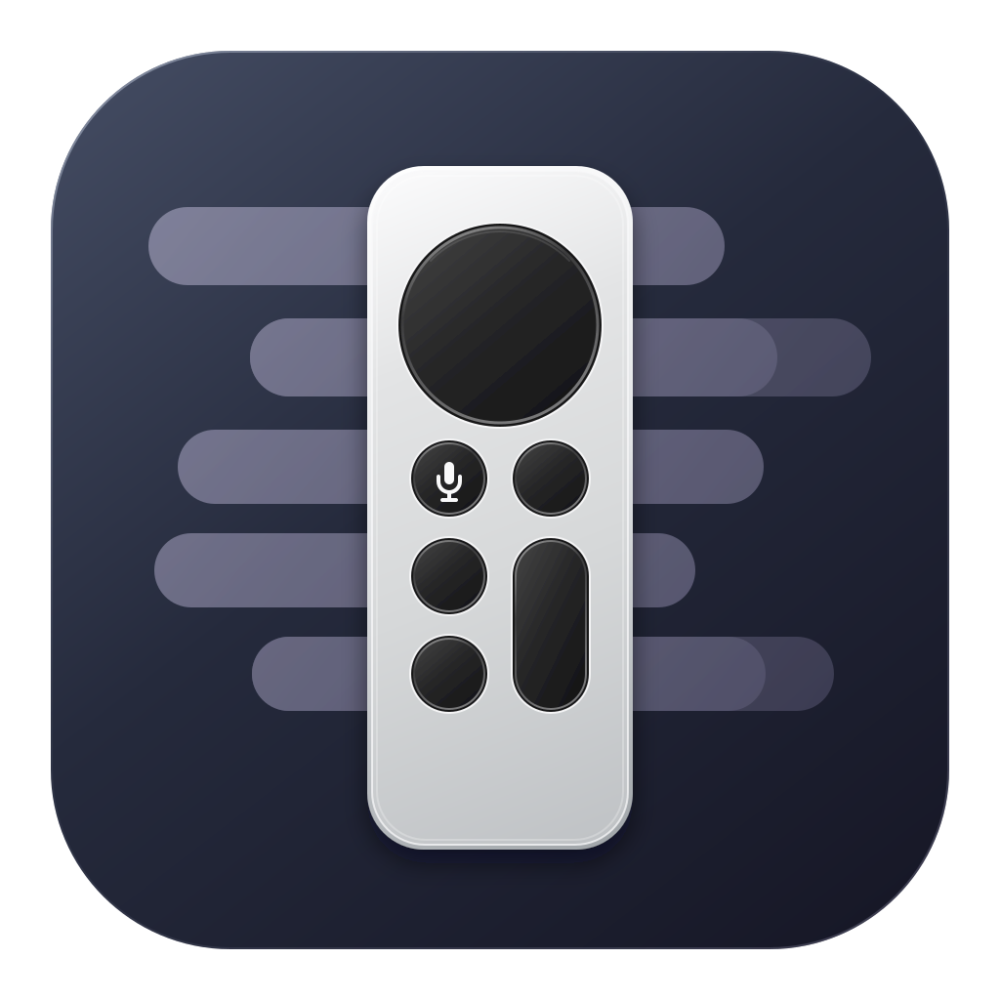
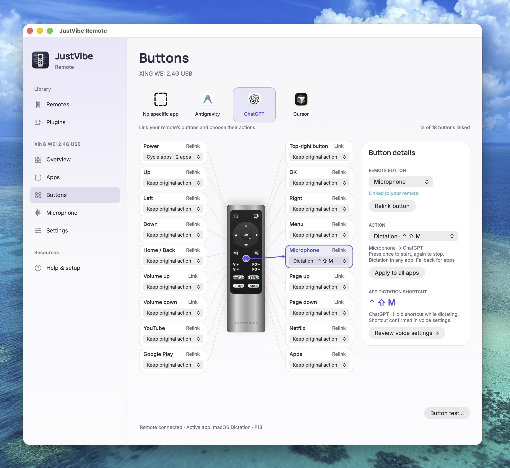

# JustVibe Remote

**Talk to your agent.**

Use a handheld remote to dictate, send prompts, navigate, and trigger shortcuts in your AI apps. Customize buttons for each app and add remote or app support through plugins.

Built for **macOS 13+ on Apple Silicon** and **Windows x64 / ARM64**. Voice input uses the target app’s dictation feature, or optional macOS Dictation across apps; compatibility depends on your hardware and plugins.

## What you can do

- **Dictate from a remote.** Link its microphone button to your app’s hold-to-talk or toggle shortcut. On macOS, optionally use **Dictation in any app**.
- **Map buttons visually.** Select a control on the remote diagram, learn its physical button, and assign an action.
- **Keep controls for each app.** Configure separate button mappings and use **Follow active app** to route controls to the app in front.
- **Open and switch apps.** Assign a button to open one app or cycle through a chosen list.
- **Add your own integrations.** Device and app plugins contain declarative JSON and documentation. The host does not execute plugin scripts or native libraries.

## Supported remotes and apps

The following plugins are bundled:

| Remote or app | Platforms | Included support |
| --- | --- | --- |
| [XING WEI 2.4G USB](plugins/bundled/org.justviberemote.device.xingwei-usb/plugin.json) | macOS, Windows | Receiver `1915:1025`, visual button layout |
| [ChatGPT](plugins/bundled/org.justviberemote.app.chatgpt/README.md) | macOS, Windows | Open app, dictation, Send, Backspace, Escape |
| [Antigravity](plugins/bundled/org.justviberemote.app.antigravity/README.md) | macOS | Open app, toggle dictation, Send, Backspace, Escape |
| [Cursor](plugins/bundled/org.justviberemote.app.cursor/README.md) | macOS | Open app, hold-to-talk dictation |

Platforms reflect the plugin manifests. Confirm shortcuts in your app and check each plugin’s setup and testing notes. Other standard USB and Bluetooth HID remotes can be supported through device plugins; proprietary protocols and Bluetooth audio need separate verification.

## Get started

1. **Download version 1.0.0** from [GitHub Releases](https://github.com/hybridknight/justvibe-remote/releases/tag/v1.0.0), or build it using the [macOS or Windows build guide](docs/wiki/Build-and-test.md). Extract the package and open `JustVibe Remote.app` on macOS, or `JustVibeRemote.exe` inside the complete Windows distribution folder. Local macOS builds are written to `dist/JustVibe Remote.app`.
2. **Test the target app’s shortcut with a keyboard.** Confirm that dictation works and whether it requires holding the keys or pressing once to start and again to stop.
3. **Connect and configure your remote.** On macOS, open **Remotes → Set up remote** and grant Input Monitoring and Accessibility when prompted. On Windows, follow the [setup and dictation guide](docs/WINDOWS-SETUP.md).
4. **Assign your controls.** Choose an app profile, link the remote buttons, and assign actions. For voice, select the intended microphone in the target app, then focus its input and try the remote.

See [Getting started](docs/wiki/Getting-started.md) for button testing, microphone setup, and the full walkthrough.

## Privacy

JustVibe Remote runs locally, with no network client, telemetry, or audio uploads. It does not store microphone recordings or dictated text. The optional five-second microphone test starts only when you request it, and its audio stays in memory.

Target apps handle dictation separately and may send audio to their own services. Their microphone settings and privacy policies apply. See [privacy and permissions](docs/wiki/Privacy-and-permissions.md).

## Documentation

Setup, build instructions, button configuration, dictation, plugins, and privacy details are in the [wiki-ready documentation](docs/wiki/Home.md).

GitHub Wiki will be published after this repository becomes public. Until then, browse the pages here:

- [Getting started](docs/wiki/Getting-started.md)
- [Build and test](docs/wiki/Build-and-test.md)
- [Dictation in any app](docs/wiki/Dictation-in-any-app.md)
- [Privacy and permissions](docs/wiki/Privacy-and-permissions.md)
- [Plugins and apps](docs/wiki/Plugins-and-apps.md)
- [Status and limitations](docs/wiki/Status-and-limitations.md)

For contributors, the [technical guides](docs/) remain with the source. See [publishing the wiki](docs/WIKI-PUBLISHING.md) when GitHub Wiki is enabled.

Development uses **Git Flow**: features merge into `develop`, and release branches merge into `main`. GitHub Actions tests and packages macOS and Windows builds; version tags prepare draft releases. See [development and releases](docs/DEVELOPMENT.md) for the workflow.

## Status

Version 1.0.0 packages are available for macOS ARM64 and Windows x64 / ARM64. The macOS release is ad-hoc signed and is not Apple-notarized; Windows releases are not Authenticode-signed. The Windows x64 package has been built and run on Windows; physical receiver behavior and Windows dictation still need live acceptance testing. Windows custom actions run alongside native button actions.

On macOS, multiple remotes require distinct receiver hardware IDs. Cursor controls adjust native speed and acceleration only. See [status and limitations](docs/wiki/Status-and-limitations.md) for the full validation and live-test status.

## License

[GNU General Public License v3.0](LICENSE) (`GPL-3.0-only`).
