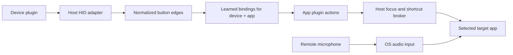

# JustVibe Remote plugin system — APIs 1, 2 and 3

## Decision

Device support and target-app support are independently installable plugins. XING WEI and Codex use the same manifest contract as community plugins. The host owns operating-system access, input/output lifecycle, foreground checks, settings, and shortcut cleanup.

Supported plugins are **declarative JSON**, not native libraries or executable scripts. Anyone can create a plugin using a text editor and the supplied templates. This supports standard HID remotes and apps controlled by keyboard shortcuts without adding runtime dependencies or requiring creators to compile Swift and C# separately.

Proprietary device protocols need additional host adapters. An executable-provider API is a future design, described below; it is not enabled by this implementation.



## Compatibility and visual layouts

Existing schema/API `1/1` plugins remain supported. Schema/API `2/2` adds a required `device.layout` for visual device plugins, with stable control IDs and up to 48 drawn controls. Held-shortcut app plugins remain `1/1`. macOS-only app plugins may use `3/3` for toggle dictation (see below). This version change does not enable executable plugins. Older hosts reject the new version rather than silently ignoring its layout.

The native UIs draw the same declarative geometry and use it for selection. A remote photo can be traced into this data without modifying core code. See [image-to-plugin authoring](IMAGE-TO-PLUGIN.md). Hardware signal learning remains independent of the drawing.

## Two plugin kinds

| Kind | Plugin supplies | Host supplies |
| --- | --- | --- |
| `device` | Hardware identity, supported adapter, consumer report layout, audio availability | Device filtering, connection events, report parsing, normalized usages, learning, macOS mapping leases |
| `app` | App identities per platform, supported semantic actions, platform shortcut suggestions | Process/window focus, user shortcut overrides, input injection, held-key cleanup |

A device plugin and app plugin have no dependency on one another. The user can pair any installed device plugin with any installed app plugin.

The host's semantic intents are `focus`, `dictate`, `send`, `backspace`, and `escape`; `native` is the host's passthrough action. An app plugin declares which intents it provides. New app support can change Send to a different shortcut without modifying native output code. Unsupported intents become native when the user switches plugin pairs.

## Package layout

```text
com.example.justviberemote.editor/
    plugin.json
    README.md          # recommended
    LICENSE            # recommended; creator chooses the license
```

Only `plugin.json` is read. Other package files are documentation; they are never executed. No entrypoint, script, dynamic-library, install-hook, command, arbitrary macro sequence, or relative executable path is accepted.

The folder name should match the plugin ID for clarity. Identity comes from the manifest, not the folder name.

Bundled plugins live in `plugins/bundled/` in the source tree. Packaging copies them to:

- macOS: `JustVibe Remote.app/Contents/Resources/plugins/`
- Windows: `<application folder>/plugins/`

Community plugins live outside the app, so a host update does not replace them:

- macOS: `~/Library/Application Support/JustVibeRemote/plugins/`
- Windows: `%APPDATA%/JustVibeRemote/plugins/`

Use **Plugin folder…** in JustVibe Remote, copy a complete plugin folder there, then choose **Reload plugins**. Loading manifests does not activate every installed plugin. Only the selected device/app pair can run through the host adapters after Start.

## Manifest contract

Common fields:

| Field | Meaning |
| --- | --- |
| `schemaVersion` | Manifest structure version; `1` for legacy plugins; `2` for visual device plugins |
| `apiVersion` | Host behavior contract; `1` for legacy plugins; `2` for visual device plugins |
| `id` | Stable lowercase, namespaced identifier such as `com.example.justviberemote.editor` |
| `version` | Plugin release version, e.g. `1.0.0`; separate from host API compatibility |
| `name`, `author` | Display metadata; these are not authenticated publisher identities |
| `kind` | Exactly `device` or `app` |
| `platforms` | Supported platforms: `macos`, `windows`, or both |
| `capabilities` | Exact supported adapter capabilities; not OS permissions or permission grants |
| `device` / `app` | Exactly one kind-specific payload |

The structural schema is [plugin.schema.json](../plugins/plugin.schema.json). The native validators also check semantic conditions, including report offset bounds, target identities, supported shortcut grammar, action operations, and required platform coverage. Use the creator tool in addition to editor schema validation.

Unknown fields, unsupported operations, unsupported capabilities, mixed plugin kinds, and unsupported API/schema versions are rejected. Plugin versions are not used to guess compatibility. There is no automatic downgrade or attempt to execute an unsupported adapter.

### Device payload

The current adapter is `hid.standard`. For its optional API 2 visual controls, see [the layout contract](IMAGE-TO-PLUGIN.md). A legacy profile payload looks like:

```json
"device": {
  "adapter": "hid.standard",
  "profile": {
    "schemaVersion": 1,
    "id": "example-remote",
    "name": "Example USB remote",
    "vendorId": 4660,
    "productId": 22136,
    "audio": "none",
    "consumerReportId": 2,
    "consumerReportLength": 3,
    "consumerUsageOffset": 1
  }
}
```

IDs are decimal JSON integers. This example uses `1234:5678` hexadecimal as a template, not a verified remote. The consumer layout describes a report-ID byte followed by a 16-bit little-endian usage. The offset includes the report-ID byte. Windows uses these fields only as a legacy fallback when the OS HID descriptor cannot be obtained. Normally Windows parses button arrays and bitfields using the OS HID parser; macOS reads usages through HID element descriptors. Existing manifests, API versions, and saved bindings remain compatible.

Use capabilities `["hid.standard"]` with `audio: "none"`, or `["hid.standard", "audio.native-input"]` with `audio: "native-usb-microphone"`. Audio capability is metadata. Normal dictation uses the target app’s audio input; the host does not route audio to it. The optional Microphone test captures a selected input for up to five seconds locally, only after the user starts a test. A remote without its own microphone can still control dictation using the input chosen in the target app.

The adapter supports standard keyboard, consumer-button, and system-control HID usages. Merely changing a VID/PID does not implement a vendor protocol or proprietary Bluetooth microphone transport. Windows descriptor parsing covers button usages, including standard button bitfields; arbitrary value fields and vendor-defined data are not decoded as buttons.

### USB and Bluetooth HID remotes

The `hid.standard` adapter works with devices exposed as HID by the operating system, whether connected through a USB receiver, a USB cable, or OS-managed Bluetooth pairing (including Bluetooth LE HID when exposed by the OS). App plugins and app mappings do not depend on the connection type. Pair Bluetooth devices in system settings first; JustVibe Remote does not perform pairing, Bluetooth GATT handshakes, or driver installation.

Device filtering still requires the plugin's exact observed vendor/product IDs. macOS uses IOHID matching without a USB transport restriction. Windows prefers numeric Raw Input HID identity and uses explicit USB/Bluetooth PnP identity tokens for keyboard interfaces, whose Raw Input device info does not contain vendor/product IDs. Name-only devices and devices without usable IDs are not captured as a workaround. Bluetooth vendor-ID namespaces are not publisher authentication. If USB and Bluetooth modes expose different IDs, create separate device plugins with the observed identities; bindings remain separate per device/app pair.

Windows keeps pressed buttons separately by interface, report ID, and usage page. It emits one press while any matching stream holds that usage and one release after the final stream clears it. Batched reports retain their order; failed parses and unrelated report IDs do not release earlier buttons. Report ID zero is supported by the descriptor parser. Once a descriptor is available, a failed report parse never falls back to guessing the legacy byte layout. Disconnecting a tracked interface clears held state and releases the active shortcut.

The existing manifest contract still requires the bounded legacy consumer-layout fields. Record a verified fallback layout if available; descriptor-only devices must document that these compatibility fields are not hardware evidence and that fallback operation is unverified. Do not claim that an existing older host gains descriptor parsing merely by loading a new JSON file.

Bluetooth button support does not imply Bluetooth microphone support. Use `audio: "none"` unless the existing native USB microphone capability is evidenced. Dictation can use the input selected in the target app, independently of the remote's connection.

Acceptance checks require actual hardware on each claimed platform: test USB and Bluetooth separately, learn keyboard and media buttons, hold simultaneous buttons, disconnect/reconnect during held dictation, and confirm another keyboard is ignored. Test the same button with two app profiles and an unsupported foreground app, including switching focus during a hold. Automated decoder tests and a successful cross-build do not replace these checks or establish support for every Android TV remote.

Implementation references: [Windows Raw Input device information](https://learn.microsoft.com/en-us/windows/win32/api/winuser/nf-winuser-getrawinputdeviceinfow), [HID button parsing](https://learn.microsoft.com/en-us/windows-hardware/drivers/ddi/hidpi/nf-hidpi-hidp_getusages), and [Bluetooth PnP identities](https://learn.microsoft.com/en-us/windows-hardware/drivers/bluetooth/installing-a-bluetooth-device).

### App payload

The current adapter is `shortcuts`, with capabilities `["target.focus", "input.shortcuts"]`.

```json
"app": {
  "adapter": "shortcuts",
  "targets": {
    "macos": {"bundleIds": ["com.example.editor"], "names": ["Example Editor"]},
    "windows": {"bundleIds": [], "names": ["ExampleEditor"]}
  },
  "actions": {
    "focus": {"operation": "focus"},
    "send": {
      "operation": "tap-shortcut",
      "shortcuts": {"macos": "CMD+RETURN", "windows": "CTRL+ENTER"}
    }
  }
}
```

App identities are bundle IDs, display names on macOS, or process names without `.exe` on Windows. They are not paths or command lines. The user can explicitly choose an application path in the UI to override discovery; the plugin cannot choose an arbitrary executable path.

`focus` is required. Other semantic actions are optional:

- `dictate` uses `hold-shortcut` in API 1. macOS-only schema/API `3/3` also supports `toggle-shortcut`; physical remote hold/toggle activation remains managed by the host.
- API 3 currently requires `platforms: ["macos"]`. Windows runtime toggle injection is not implemented or claimed. Both validators enforce this boundary.
- `toggle-shortcut` sends a complete start tap and a complete stop tap to the original app process. Stop never focuses an unrelated app. Process exit clears the lease; a reused PID cannot receive the old stop command. Failed key-up cleanup retries without posting a second toggle. OS event posting does not prove the app changed recording state; users should not mix manual app toggles with an active remote session.
- `send`, `backspace`, and `escape` use `tap-shortcut`.
- A shortcut must be present for every platform the plugin declares.
- Shortcuts use `+`-separated key tokens. Supported named keys are `SPACE`, `RETURN`/`ENTER`, `ESC`, and `BACKSPACE`, plus letters A–Z.
- Modifiers: `CTRL`, `CONTROL`, `SHIFT`, `ALT`; macOS also supports `OPTION`, `CMD`, `COMMAND`; Windows also supports `RALT`, `WIN`.
- macOS requires zero or more modifiers followed by one ordinary key. At most five tokens are accepted.

The user must still confirm the dictation shortcut against their app settings. A manifest suggestion is not proof of an app's current defaults. Switching app plugins clears that confirmation and the previous application's path override.

## Discovery and conflicts

1. Scan one directory level under the bundled and community roots.
2. Ignore hidden folders and symbolic-link/reparse-point plugin folders.
3. Reject symbolic-link manifests and manifests larger than 64 KiB.
4. Decode and validate each manifest independently.
5. Skip plugins that do not support the current platform.
6. Resolve IDs deterministically. A community plugin cannot replace a valid bundled ID. Both copies of a duplicated community ID are excluded; the loader does not pick whichever happened to be read last.
7. Expose valid plugins in the two selectors. Keep errors as diagnostics so one malformed package does not prevent other packages from loading.

If the selected plugin is missing, invalid, or incompatible, Start fails with a clear message. The host does not silently switch to a different remote or app. Bundled starter selections are preferences only; hardware knowledge and shortcut suggestions are still read from manifests.

There is no automatic file watcher or network marketplace in v1. To update, stop the app's active session, replace the plugin folder, and Reload. To disable, move a package outside the plugin directory or rename its folder with a leading dot, then Reload. To uninstall, remove its folder and Reload. Local binding data remains so the user can reinstall later.

## Session lifecycle

```text
discover → validate → select device/app → Start → listen / invoke
                                      ↓
                     Stop / reload / change selection
                                      ↓
              cancel pending actions → release held shortcut
              → close input adapter → restore mapping leases
```

Reload stops the session before replacing the catalog. Changing the selected pair also releases the old shortcut and input adapter first; it may restart after saving settings if it was running. A failed release prevents successful Stop/reload rather than pretending the key was released. Disconnected mapping leases retain their existing restoration journal.

Visual device plugins define up to 48 controls. Legacy plugins retain their generic six-slot layout. The host can retain up to 64 bindings, including unmatched legacy controls; an upgrade exceeding that limit is rejected rather than silently dropping learned mappings.

Bindings are stored under the device-plugin/app-plugin ID pair. Changing device or app does not erase learned bindings for the previous pair. Plugin display names and release versions are not used as storage keys.

The host retains its existing protections: foreground checks, timeout, device-removal cleanup, and OS permission checks. Plugin reload does not bypass them. Windows native-event replacement remains unsupported; plugins cannot request global suppression as a workaround.

## Creator workflow

For coding agents, start with [the agent authoring workflow](PLUGIN-AUTHORING.md). Both templates include portable `AGENTS.md` instructions, an API guide, schema snapshot, and acceptance notes. Keep a copied plugin in a separate project so updating the host does not merge integration patches.

1. Copy `plugins/examples/device/` or `plugins/examples/app/` to your own folder.
2. Choose your own stable namespaced ID and fill in observed hardware details or the app's verified identities and shortcuts.
3. Keep only platforms you can describe correctly. There is no requirement to implement both.
4. Validate using the .NET 10 SDK:

   ```sh
   dotnet run --project windows/JustVibeRemote.PluginTool -- validate path/to/your-plugin
   ```

5. Include a README explaining verified device/app versions, setup, microphone behavior, limitations, and how you tested it. Choose a license for your package.
6. Drop the folder into JustVibe Remote's community plugin directory and Reload. Choose it explicitly and test button learning and actions.
7. Share the folder or a ZIP containing that folder. JustVibe Remote v1 does not download or extract ZIPs itself.

The host test suites consume the same `plugins/tests/conformance.json` cases, so both platform validators are checked against the same accepted and rejected manifests.

## Trust boundary

Declarative does not mean harmless: a plugin's shortcuts can trigger actions in its declared target app. Review the manifest and use plugins you trust. The v1 restriction prevents a plugin package from executing its own scripts or native code; it is not an operating-system sandbox or publisher signature system.

The host never grants access merely because a manifest lists a capability. Device plugins cannot request wildcard/all-device capture, filesystem access, or network access. They must declare an explicit hardware identity, which the user can inspect in the UI. App plugins cannot define shell commands or executable paths. The existing OS consent remains with the host application.

## Future executable-provider API — not implemented

Some Android remotes need code for Bluetooth GATT handshakes, proprietary audio decoding, or custom report layouts. Those should use a separately versioned provider API, not load arbitrary DLLs into the UI process.

Proposed contract:

- One out-of-process provider per selected plugin, with a versioned JSON-RPC control channel and bounded binary frame channel.
- `initialize`, `probe`, `open`, `close`, and `shutdown` lifecycle messages; negotiated API versions and explicit capability grants.
- Input providers emit normalized button edges and optional decoded PCM frames. App providers request host-brokered semantic actions; the host retains focus checks and key ownership.
- Device-scoped opaque handles rather than global HID/Bluetooth handles. Per-plugin settings and data directories.
- Timeouts, cancellation, process-exit handling, and unconditional host-side release of held shortcuts when a provider fails.
- Platform-specific sandbox enforcement and an explicit executable trust/approval policy before this mode is enabled. A separate process alone does not provide confinement.

No executable package, RPC server, provider process, or sandbox claim is part of APIs 1 or 2. Unsupported protocols currently fail validation and require a host adapter change.

## Automatic active-app mappings

JustVibe Remote can follow the foreground app using the existing `app.targets` identities. No manifest/API change is required. Users configure each installed app plugin once, assign button actions, and enable **Follow active app**. Each device/app pair keeps independent actions and voice settings. Unknown and ambiguous app matches receive no custom action.

Use accurate bundle IDs on macOS and process names (without `.exe`) on Windows. Prefer specific identities over broad display names. An optional user-selected application path takes precedence and can disambiguate overlapping plugins. Identity matching does not authenticate an application's publisher. Agents should include a focus-switch acceptance test: configure two app profiles with different actions on the same button, switch between them, then switch to an unsupported app; verify the expected action, native fallback, and release of held dictation shortcuts.
