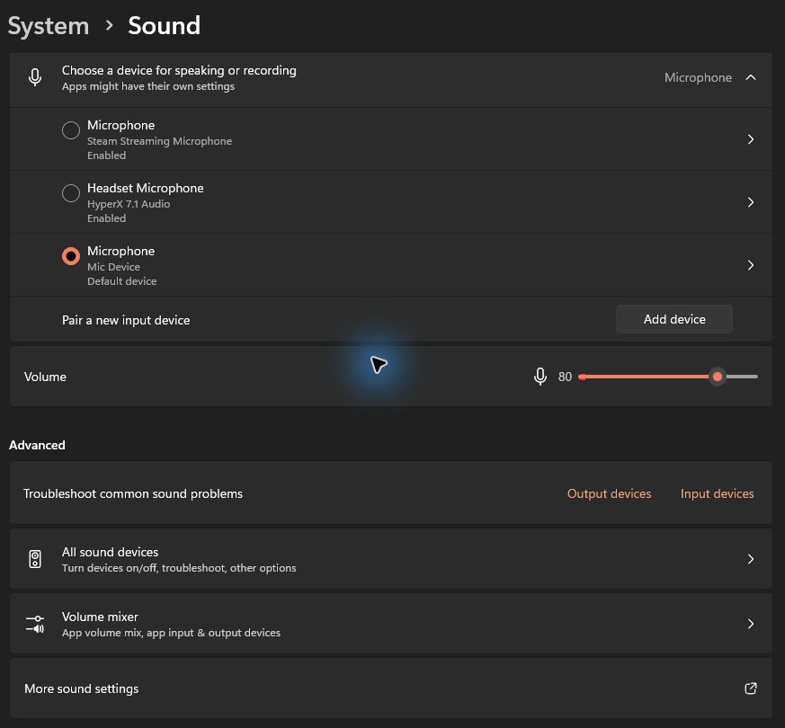

# Windows setup and dictation

Start with a working keyboard shortcut in your target app, then make the remote send that same shortcut. Configure the microphone separately: JustVibe Remote sends keys; Windows and the target app handle your voice.

## 1. Open JustVibe Remote and connect

Keep the entire Windows release folder together and open `JustVibeRemote.exe`. The packaged release includes its runtime; the .NET SDK is only needed to build from source.

Plug in the receiver, select your remote, and connect it. The workspace should show **Connected**. You can use **Help & setup** to resume the setup guide.

## 2. Check dictation with your keyboard

Open the target app and click its message input. Test its dictation shortcut on a real keyboard before configuring the remote. Check how the app starts and stops listening.

For the ChatGPT installation used during this setup, the user verified **Ctrl+Shift+D** on the keyboard. Use the shortcut that works in your own installation. A plugin's suggested shortcut can differ from your app's setting, and existing saved overrides are preserved.

If keyboard dictation fails, resolve the shortcut and microphone selection in the target app first.

## 3. Link the button in the correct app profile

1. Open **Buttons** and select **ChatGPT**, or your intended app, in the app profile row.
2. Select **Microphone** on the remote diagram. Choose **Link** or **Relink button**, then press the physical microphone button once.
3. Set its action to **Dictation**.
4. Open **Review voice settings**. Enter the shortcut that worked on your keyboard, check **Matches my app's hold-to-dictate shortcut**, and choose **Save voice settings**.

The button details should show your shortcut and **Confirmed for this app**. Linking identifies the button; assigning Dictation determines what it does. Both are needed. **No specific app** is a separate profile for shared controls; configure app dictation under the target app's profile.

Windows app dictation currently sends a held shortcut. With **Press once to start, again to stop** enabled, the first remote press holds the keys and the next releases them. With it disabled, the keys follow the remote button's press and release. For a receiver that reports only a short microphone pulse, use the first option with a compatible held shortcut. This option changes the remote's behavior; it does not convert an app's toggle-only command into a held dictation command.

## 4. Select the remote microphone

1. Open **Microphone → Choose & test microphone…** in JustVibe Remote.
2. Select the remote's audio input. In this session it was named **Microphone (Mic Device)**. Names can be generic, so a matching name alone does not identify the physical microphone. The displayed input number can change; it is not the saved microphone identity.
3. Keep **Block remote dictation when system input differs** enabled if you want JustVibe to require the selected microphone before sending dictation keys.
4. Choose **Save microphone choice**.

To check the physical audio source, you can explicitly choose **Start 5-second test**, speak near the remote, and play it back. Opening this dialog does not start recording. The preview stays locally in memory and is cleared when the dialog closes. A successful preview confirms only this input, not the microphone another app uses.

## 5. Set both Windows microphone defaults

In the app, choose **Microphone → Windows microphone setup with screenshot** to view these steps beside an actual Windows Sound screenshot.

Selecting an input in JustVibe saves a preference; it does not change Windows' defaults or the target app's input.

1. Open **Windows Settings → System → Sound** and select the remote microphone under **Input**.
2. Open **More sound settings → Recording**. Right-click the remote microphone and set it as **Default Device** and **Default Communication Device**, wherever those options are available. An option may be absent if the device already has that role.
3. Return to JustVibe's microphone dialog. Its status should say **All Windows input defaults match this mic**. The dialog refreshes this check while open.
4. In the target app, select the remote microphone or **System Default**, if the app offers an input selector.
5. **Close the microphone-test dialog before dictating.** JustVibe blocks remote dictation while that dialog is open, even when no preview is recording.

Choosing the remote under Windows' main Input setting may leave the communications default on another microphone. The input-match check requires all Windows input roles to match. Even when this check passes, the target app can override its microphone independently.

This cropped Windows screenshot shows the regular default input. Use **More sound settings → Recording** to set the communications default separately. Device names and other available inputs vary by computer.

## 6. Try the remote in the target app

Open the target app, click its message input, and use the linked microphone button with your chosen activation mode. Confirm that words appear and that stopping works.

If **Follow active app** is enabled, JustVibe uses the configured profile for the foreground app. The profile displayed in the editor is separate from that routing. Unsupported or ambiguous app matches do not receive custom app actions.

## When dictation does not start

Read the status message at the bottom of JustVibe Remote after pressing the remote button.

| What you see | What to do |
| --- | --- |
| **System input is not the selected remote microphone… no shortcut was sent** | Set both Windows defaults in step 5. This check blocks the keyboard shortcut before it reaches the app. |
| **Selected microphone is disconnected** or a similar microphone warning | Reconnect the receiver and check the saved input in the microphone dialog. Do not select a different device based only on its name. |
| **Match the shortcut… and check Confirmed** | Open the target app's profile, review voice settings, confirm the working shortcut, and save. |
| **Close Microphone test before starting dictation** | Close that dialog, then retry in the app. Stopping the preview alone is not enough. |
| **The selected app is not in front** or **The active app changed** | Focus the intended app and its text input, then press the remote button again. Check the configured app location if targeting fails. |
| **Dictation shortcut held**, but no text | Test the same shortcut on your keyboard again. Check the app's microphone and whether it expects held keys. This status confirms key output, not audio or transcription. |
| No dictation status | Check connection, the physical button link, its Dictation action, and the active app profile. Close **Button test…**, which pauses mapped output during testing. |

**Windows voice typing** is a separate option that sends **Win+H**. Windows manages its listening and stopping. Leave that option off while troubleshooting the target app's own dictation shortcut.

## Verification notes

During the Windows troubleshooting session on 2026-10-31, the user reported that ChatGPT's **Ctrl+Shift+D** keyboard shortcut worked and later confirmed they could talk using the remote microphone after setup. JustVibe's unconfirmed shortcut and microphone-default mismatch were observed during troubleshooting. This is one local setup result; other receivers, app versions, activation modes, and focus-switch behavior still need their own live checks.
